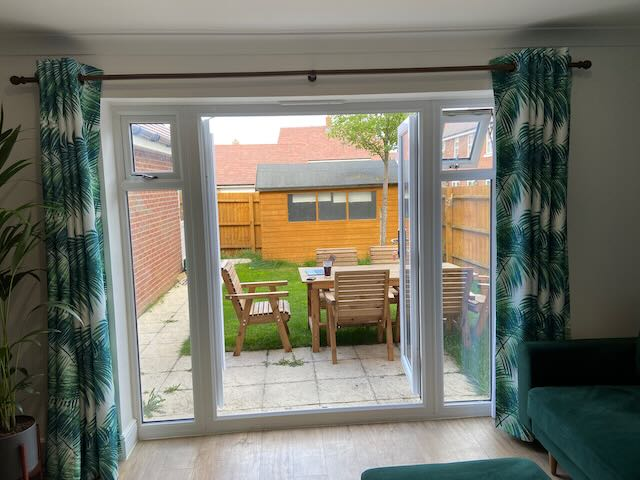
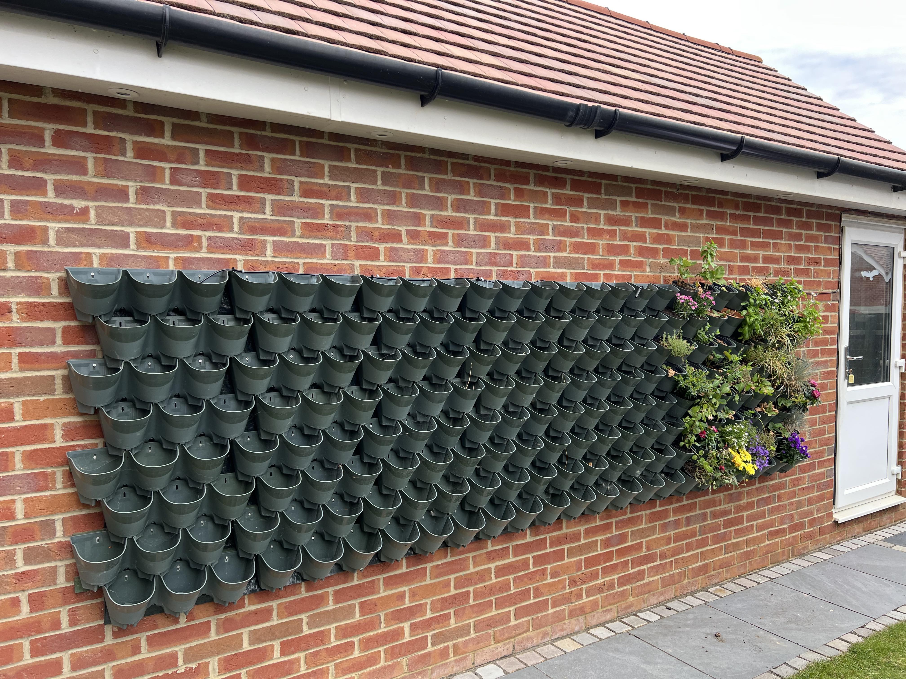
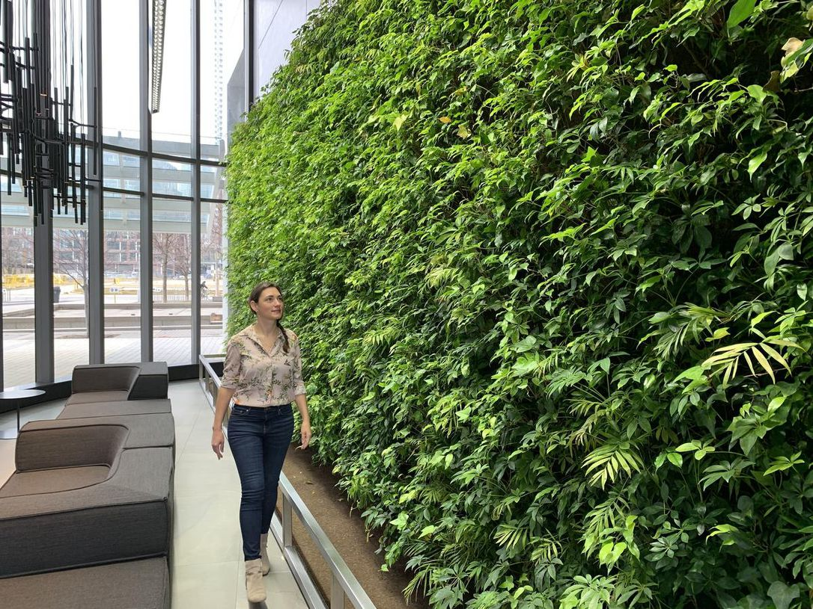

_This blog is the intro to a series of posts about our outdoor plant wall. I will later add some links here to the second post which will be about how we built the wall, and the third post which will be about how we built and automated (still a WIP!) the process of irrigating it._

Last year, my partner and I bought our first house. This was the view from our living room:

The major issues with our garden were:
1. It's a new build - the grass was suffering from the soil quality being rubbish, due to the fact pretty much all new build home gardens are filled with builder's rubbish and then covered over with soil.
2. The major thing you see is a view of a massive shed, which we don't need, because we've got a garage right next to it.
3. The other thing your eye is drawn to is our garage wall.

Steps 1 and 2 were pretty boring - my dad dismantled the shed, then enlisted my partner and my brother in law to move it to my sister's garden.

For step 2, we had the entire garden redone professionally...which leaves issue 3, which is a much more difficult task.

Enter: the plant wall!

It's not at all full at the moment, but the idea is it will get to the state of being a "living" wall, the kind that you see on commercial buildings. 

Our plant wall consists of [two wonderwall "self watering" kits](https://www.crocus.co.uk/product/_/wonderwall-vertical-planting-kit-23m2-wall/classid.2000044785/?gclid=Cj0KCQjwr4eYBhDrARIsANPywCiYR4f_-wgoXnmRZDbuMefLGcOAvH5ycCkQ9R3gYAcAq5nsqSlOnE0aAgEdEALw_wcB), mounted on long wooden battens screwed into the wall at the beginning, middle and end, mounted in front of a big green tarpaulin to ensure if there are any leaks, nothing grows on the wall behind, mounted to the garage wall. The wall can at max hold 198 plants in 12cm plant pots. (You can also just put soil directly in the planters if you add a filter to the self watering holes).

### Self watering turned out to be a con
By self watering, what Wonderwall mean is the classic "just add your own water". When you add water to the top line of planters, the plants should [bottom water](https://www.gardeningknowhow.com/houseplants/hpgen/bottom-watering-plants.htm) and as it fills past that level, there are two holes per planter which drip into the row below.

https://user-images.githubusercontent.com/4128117/185787998-5a454a86-0b6a-4aaa-8406-58cd765c7db6.mov

I was initially pretty skeptical about whether this would ensure good plant health. Plants typically don't like being sat in water for long periods of time and can suffer from root rot (I had to remove and re-pot my monsterra because of this!).

In actual fact I've found this is a much better solution than top-watering. The planters are designed with a stand for the plants to sit on, which ensures they are raised to just high enough that the plants can absorb more water without being completely submerged. 
[TODO PIC]

I did find that you have to push hard to ensure the plants are in the right position below row 1 - 12cm is pretty much the max size you can fit in and still have the design work as intended.

We've also typically gone with very leafy or bushy plants which makes the soil much more difficult to reach, so overall, despite it looking inefficient or unhealthy at first glance, it probably is a more efficient way of ensuring your plants get watered when they are mounted vertically.

## Benefits

The main reason for installing the plant wall was to cover up the garage wall with something that blended in with the garden but didn't look totally rubbish.

The other benefit is in a small garden, you can now effectively have two flower beds, and this one has a lot more flexibility in that you can move plants in and out easily, and you can move them around as you like without needing to dig them up.

In our garden, the opposing flower bed is partial shade, which means we've predominantly gone with very leafy, hardy plants, so the plant wall allows us to grow things which need full sun - predominantly plants with a lot of flowers which we like.

The wall is also at a much easier height to manage things like herb and veg gardens.

## Drawbacks

### Irrigation
The major issue (and the reason for this blog series) is there are 198 plants to water at full capacity. When we first bought the house, I was worried enough about maintaining our new house plants, as I was previously pretty good at killing plants. 

[PIC HERE]

After we managed to kill quite a few plants my mum had kindly provided, (the majority gave up the ghost while we were on holiday), I put my foot down and insisted we get on with producing a functioning irrigation system before we added any more plants. 

Without an irrigation system, we fould we needed to water all the plants at least once a day, and potentially twice a day in the height of summer, in particular 2022's heat waves. Plants in containers need more water because there isn't ground water for them to draw on, only whatever water is in the soil they are planted in. This isn't such a problem when we're here, but whilst on holiday it's not really fair to ask our family and friends to pop in every single day to make sure they stay alive.

### Watering in a heatwave
In a heatwave there is always talk of hosepipe bans. 

Thankfully, our area's water company is Anglian water, [who have not (and don't intend to) bring in a hosepipe ban since they have managed their water pipes and resevoirs well enough to avoid it](https://www.youtube.com/watch?v=V8cgCSyJfUk). Still, ideally we preferred to reach the point where we could water the plants using rain water over hosepipe since these plants are going to need a more concerted effort as described above.

### Plant size
Obviously, the other thing to note is while the plant wall acts as a vertical flower bed, you need to ensure the plants you get will cope well with being in 12cm pots. 

The bulk of our first lot of flowers were pansies and primroses. I later added supermarket herb plants (mint, basil, thyme, rosemary) which I generally divided into 2-4 pots each to ensure they wouldn't struggle from being root bound. 

Strawberries seem to also work well and it's great being able to just stick another pot of soil in whenever the current strawberry plants produce new runners (one of the ways strawberries produce offspring is to literally create a whole new plant for you by having a trailing limb with some leaves on it).

I've had moderate success splitting plants by just dividing them with my hands - herbs are super easy because they typically _are_ lots of plants shoved into one pot, but grasses I had to divide with a kitchen knife due to the root block being very thick, and I killed half a lavender plant trying to do the very same thing.

### Expense
If you buy 198 plants from a garden center, that's going to cost you a lot of money. We bought 5 in one day and that cost £40. The bulk of our plants going forward will be [plug plants](https://www.brooksidenursery.co.uk/what-are-plug-plants.html) which we will be bringing to full size in our propagator (basically a mini greenhouse) before putting them into 12cm pots.

We also bought 200 black 12 cm pots when we bought the wall - these came in at around 10p per pot on eBay.
